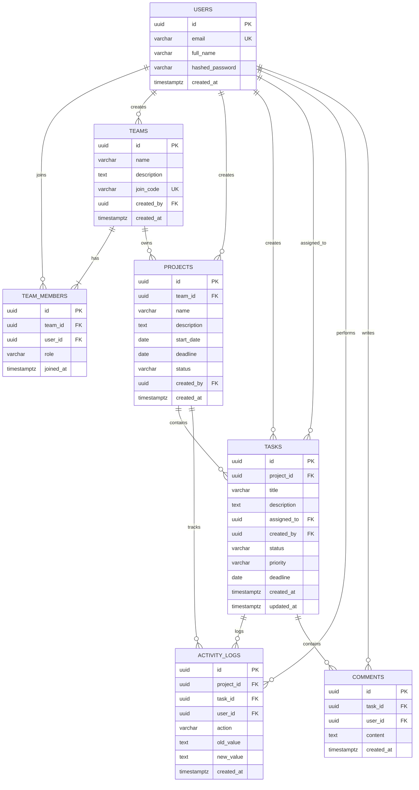

# Crewboard — Database Architecture & Schema Specification

## 1. Overview & Data Design Principles

The database design for Crewboard follows standard **Third Normal Form (3NF)** with strict relational integrity, defensive cascading rules, and deterministic foreign key constraints.

### Core Architectural Decisions
1. **Primary Keys (`UUIDv4`)**: All primary keys utilize standard 128-bit UUIDs (`gen_random_uuid()`). This prevents ID guessing, enumeration attacks, and unauthorized sequential crawling across teams (critical for college multi-tenant integrity).
2. **Timezone Awareness**: All timestamp fields are explicitly stored as `TIMESTAMPTZ` (UTC) to avoid server/client timezone drift.
3. **Cascading Strategy**:
   - Deleting a `team` cascades to `projects`, `team_members`, and indirect children (`tasks`, `activity_logs`).
   - Deleting a `project` cascades to `tasks` and `activity_logs`.
   - Deleting a `user` sets `assigned_to` on tasks to `NULL` (`ON DELETE SET NULL`) while preserving historical task records. Deleting a user who created entities is protected via `ON DELETE RESTRICT` (ensuring institutional project history remains intact).
4. **Relational Indexing**: Foreign keys, search codes (`join_code`), email lookups, and frequently filtered fields (`status`, `assigned_to`, `created_at`) are explicitly indexed to guarantee high performance.

---

## 2. Entity-Relationship (ER) Diagram



---

## 3. Detailed Table Specifications

### 3.1 `users`
Represents registered students and contributors on the platform.

| Column | Type | Nullable | Default | Description & Constraints |
| :--- | :--- | :--- | :--- | :--- |
| `id` | `UUID` | No | `gen_random_uuid()` | Primary Key. |
| `full_name` | `VARCHAR(100)` | No | None | User's display name. |
| `email` | `VARCHAR(255)` | No | None | Unique login email. Indexed (`ix_users_email`). |
| `hashed_password` | `VARCHAR(255)` | No | None | Salted Argon2 password hash. Never exposed via API. |
| `created_at` | `TIMESTAMPTZ` | No | `now()` | Timestamp of registration. |

- **Indexes**:
  - `ix_users_email` (UNIQUE): Fast login lookups and duplication prevention.

---

### 3.2 `teams`
A bounded group of students collaborating on shared academic coursework.

| Column | Type | Nullable | Default | Description & Constraints |
| :--- | :--- | :--- | :--- | :--- |
| `id` | `UUID` | No | `gen_random_uuid()` | Primary Key. |
| `name` | `VARCHAR(100)` | No | None | Team / group title (e.g., "Robotics Lab Group 4"). |
| `description` | `TEXT` | Yes | `NULL` | Optional summary of team charter or subject. |
| `join_code` | `VARCHAR(12)` | No | None | Unique alphanumeric join code (e.g., `CREW-8392`). Indexed (`ix_teams_join_code`). |
| `created_by` | `UUID` | No | None | FK -> `users(id)` ON DELETE RESTRICT. |
| `created_at` | `TIMESTAMPTZ` | No | `now()` | Timestamp of creation. |

- **Indexes**:
  - `ix_teams_join_code` (UNIQUE): Fast lookup during team-join workflows.
  - `ix_teams_created_by`: Fast lookup of teams created by a specific user.

---

### 3.3 `team_members`
Association table linking users to teams, establishing tenant boundaries and access privileges.

| Column | Type | Nullable | Default | Description & Constraints |
| :--- | :--- | :--- | :--- | :--- |
| `id` | `UUID` | No | `gen_random_uuid()` | Primary Key. |
| `team_id` | `UUID` | No | None | FK -> `teams(id)` ON DELETE CASCADE. |
| `user_id` | `UUID` | No | None | FK -> `users(id)` ON DELETE CASCADE. |
| `role` | `VARCHAR(20)` | No | `'member'` | Role in team: `'owner'` or `'member'`. |
| `joined_at` | `TIMESTAMPTZ` | No | `now()` | Timestamp when the user joined the team. |

- **Constraints**:
  - `uq_team_user` UNIQUE(`team_id`, `user_id`): Prevents duplicate memberships in the same team.
- **Indexes**:
  - `ix_team_members_team_id`: Fast retrieval of all members in a team.
  - `ix_team_members_user_id`: Fast retrieval of all teams a user belongs to.

---

### 3.4 `projects`
A specific deliverable or milestone owned by a single team.

| Column | Type | Nullable | Default | Description & Constraints |
| :--- | :--- | :--- | :--- | :--- |
| `id` | `UUID` | No | `gen_random_uuid()` | Primary Key. |
| `team_id` | `UUID` | No | None | FK -> `teams(id)` ON DELETE CASCADE. |
| `name` | `VARCHAR(150)` | No | None | Project title (e.g., "Phase 1: Backend Architecture"). |
| `description` | `TEXT` | Yes | `NULL` | Detailed scope or submission guidelines. |
| `start_date` | `DATE` | Yes | `NULL` | Optional kick-off date. |
| `deadline` | `DATE` | Yes | `NULL` | Target final deliverable deadline. |
| `status` | `VARCHAR(20)` | No | `'active'` | Status: `'planning'`, `'active'`, `'completed'`, `'archived'`. |
| `created_by` | `UUID` | No | None | FK -> `users(id)` ON DELETE RESTRICT. |
| `created_at` | `TIMESTAMPTZ` | No | `now()` | Timestamp of creation. |

- **Indexes**:
  - `ix_projects_team_id`: Filters all projects within a team context.

---

### 3.5 `tasks`
The foundational unit of work, execution tracking, and contribution analytics.

| Column | Type | Nullable | Default | Description & Constraints |
| :--- | :--- | :--- | :--- | :--- |
| `id` | `UUID` | No | `gen_random_uuid()` | Primary Key. |
| `project_id` | `UUID` | No | None | FK -> `projects(id)` ON DELETE CASCADE. |
| `title` | `VARCHAR(200)` | No | None | Clear actionable task title. |
| `description` | `TEXT` | Yes | `NULL` | Detailed requirements or acceptance criteria. |
| `assigned_to` | `UUID` | Yes | `NULL` | FK -> `users(id)` ON DELETE SET NULL. Must belong to the project's parent team. |
| `created_by` | `UUID` | No | None | FK -> `users(id)` ON DELETE RESTRICT. |
| `status` | `VARCHAR(20)` | No | `'todo'` | Kanban state: `'todo'`, `'in_progress'`, `'done'`. |
| `priority` | `VARCHAR(20)` | No | `'medium'` | Priority level: `'low'`, `'medium'`, `'high'`. |
| `deadline` | `DATE` | Yes | `NULL` | Individual task due date for overdue checks. |
| `created_at` | `TIMESTAMPTZ` | No | `now()` | Timestamp when created. |
| `updated_at` | `TIMESTAMPTZ` | No | `now()` | Timestamp of last modification. |

- **Indexes**:
  - `ix_tasks_project_id`: Retrieves tasks for project Kanban board.
  - `ix_tasks_assigned_to`: Speeds up personal task lists and workload calculation.
  - `ix_tasks_status`: Speeds up status filtering and completion rate queries.
  - `ix_tasks_deadline`: Optimizes overdue task detection.

---

### 3.6 `activity_logs`
An append-only audit trail capturing significant task modifications and status progressions.

| Column | Type | Nullable | Default | Description & Constraints |
| :--- | :--- | :--- | :--- | :--- |
| `id` | `UUID` | No | `gen_random_uuid()` | Primary Key. |
| `project_id` | `UUID` | No | None | FK -> `projects(id)` ON DELETE CASCADE. |
| `task_id` | `UUID` | Yes | `NULL` | FK -> `tasks(id)` ON DELETE SET NULL. Nullable for project-level events. |
| `user_id` | `UUID` | No | None | FK -> `users(id)` ON DELETE CASCADE. Actor who initiated the change. |
| `action` | `VARCHAR(50)` | No | None | Action identifier (e.g., `'task_created'`, `'status_changed'`, `'task_assigned'`). |
| `old_value` | `TEXT` | Yes | `NULL` | Previous state value (e.g., `'in_progress'`). |
| `new_value` | `TEXT` | Yes | `NULL` | New state value (e.g., `'done'`). |
| `created_at` | `TIMESTAMPTZ` | No | `now()` | Immutable event timestamp. |

- **Indexes**:
  - `ix_activity_logs_project_id`: Project activity stream.
  - `ix_activity_logs_user_id`: Contributor history queries.
  - `ix_activity_logs_created_at`: Reverse-chronological sorting.

---

### 3.7 `comments` (Optional / Phase 3)
Contextual discussion threads attached directly to tasks. Documented now to ensure clean schema forward-compatibility, but strictly deferred until mandatory features pass verification.

| Column | Type | Nullable | Default | Description & Constraints |
| :--- | :--- | :--- | :--- | :--- |
| `id` | `UUID` | No | `gen_random_uuid()` | Primary Key. |
| `task_id` | `UUID` | No | None | FK -> `tasks(id)` ON DELETE CASCADE. |
| `user_id` | `UUID` | No | None | FK -> `users(id)` ON DELETE CASCADE. Author of the comment. |
| `content` | `TEXT` | No | None | Comment text content. |
| `created_at` | `TIMESTAMPTZ` | No | `now()` | Comment timestamp. |

- **Indexes**:
  - `ix_comments_task_id`: Retrieve discussion history for a task.

---

## 4. Multi-Tenant Integrity & Cross-Team Defense

### Prevention of Cross-Team Assignment
A task belonging to `Project P` (under `Team T`) **cannot** be assigned to a user who is not a member of `Team T`. While PostgreSQL foreign keys enforce that `assigned_to` refers to an existing user in `users`, relational constraints across two degrees of separation (`tasks` -> `projects` -> `teams` vs. `users` -> `team_members` -> `teams`) are enforced via database triggers or backend domain validation.

**Backend Validation Guard (Required)**:
```python
# Validation before task insertion/update:
def validate_assignee_in_project_team(db: Session, project_id: UUID, user_id: UUID | None):
    if user_id is None:
        return
    membership = (
        db.query(TeamMember)
        .join(Project, Project.team_id == TeamMember.team_id)
        .filter(Project.id == project_id, TeamMember.user_id == user_id)
        .first()
    )
    if not membership:
        raise HTTPException(
            status_code=400,
            detail="Assigned user is not a verified member of this project's team."
        )
```

### Prevention of Direct Object Access (IDOR)
To guarantee that a student cannot view or edit another team's project by supplying an arbitrary UUID in `/api/projects/{project_id}`:
```python
def get_user_project_or_403(db: Session, project_id: UUID, current_user_id: UUID) -> Project:
    project = (
        db.query(Project)
        .join(TeamMember, TeamMember.team_id == Project.team_id)
        .filter(Project.id == project_id, TeamMember.user_id == current_user_id)
        .first()
    )
    if not project:
        raise HTTPException(status_code=403, detail="Access denied to this project.")
    return project
```

---

## 5. DDL Reference (PostgreSQL 16)

```sql
-- Enable UUID extension
CREATE EXTENSION IF NOT EXISTS "pgcrypto";

-- 1. Users
CREATE TABLE users (
    id UUID PRIMARY KEY DEFAULT gen_random_uuid(),
    full_name VARCHAR(100) NOT NULL,
    email VARCHAR(255) NOT NULL UNIQUE,
    hashed_password VARCHAR(255) NOT NULL,
    created_at TIMESTAMPTZ NOT NULL DEFAULT now()
);
CREATE INDEX ix_users_email ON users (email);

-- 2. Teams
CREATE TABLE teams (
    id UUID PRIMARY KEY DEFAULT gen_random_uuid(),
    name VARCHAR(100) NOT NULL,
    description TEXT,
    join_code VARCHAR(12) NOT NULL UNIQUE,
    created_by UUID NOT NULL REFERENCES users(id) ON DELETE RESTRICT,
    created_at TIMESTAMPTZ NOT NULL DEFAULT now()
);
CREATE INDEX ix_teams_join_code ON teams (join_code);
CREATE INDEX ix_teams_created_by ON teams (created_by);

-- 3. Team Members
CREATE TABLE team_members (
    id UUID PRIMARY KEY DEFAULT gen_random_uuid(),
    team_id UUID NOT NULL REFERENCES teams(id) ON DELETE CASCADE,
    user_id UUID NOT NULL REFERENCES users(id) ON DELETE CASCADE,
    role VARCHAR(20) NOT NULL DEFAULT 'member',
    joined_at TIMESTAMPTZ NOT NULL DEFAULT now(),
    CONSTRAINT uq_team_user UNIQUE (team_id, user_id)
);
CREATE INDEX ix_team_members_team_id ON team_members (team_id);
CREATE INDEX ix_team_members_user_id ON team_members (user_id);

-- 4. Projects
CREATE TABLE projects (
    id UUID PRIMARY KEY DEFAULT gen_random_uuid(),
    team_id UUID NOT NULL REFERENCES teams(id) ON DELETE CASCADE,
    name VARCHAR(150) NOT NULL,
    description TEXT,
    start_date DATE,
    deadline DATE,
    status VARCHAR(20) NOT NULL DEFAULT 'active',
    created_by UUID NOT NULL REFERENCES users(id) ON DELETE RESTRICT,
    created_at TIMESTAMPTZ NOT NULL DEFAULT now()
);
CREATE INDEX ix_projects_team_id ON projects (team_id);

-- 5. Tasks
CREATE TABLE tasks (
    id UUID PRIMARY KEY DEFAULT gen_random_uuid(),
    project_id UUID NOT NULL REFERENCES projects(id) ON DELETE CASCADE,
    title VARCHAR(200) NOT NULL,
    description TEXT,
    assigned_to UUID REFERENCES users(id) ON DELETE SET NULL,
    created_by UUID NOT NULL REFERENCES users(id) ON DELETE RESTRICT,
    status VARCHAR(20) NOT NULL DEFAULT 'todo',
    priority VARCHAR(20) NOT NULL DEFAULT 'medium',
    deadline DATE,
    created_at TIMESTAMPTZ NOT NULL DEFAULT now(),
    updated_at TIMESTAMPTZ NOT NULL DEFAULT now()
);
CREATE INDEX ix_tasks_project_id ON tasks (project_id);
CREATE INDEX ix_tasks_assigned_to ON tasks (assigned_to);
CREATE INDEX ix_tasks_status ON tasks (status);
CREATE INDEX ix_tasks_deadline ON tasks (deadline);

-- 6. Activity Logs
CREATE TABLE activity_logs (
    id UUID PRIMARY KEY DEFAULT gen_random_uuid(),
    project_id UUID NOT NULL REFERENCES projects(id) ON DELETE CASCADE,
    task_id UUID REFERENCES tasks(id) ON DELETE SET NULL,
    user_id UUID NOT NULL REFERENCES users(id) ON DELETE CASCADE,
    action VARCHAR(50) NOT NULL,
    old_value TEXT,
    new_value TEXT,
    created_at TIMESTAMPTZ NOT NULL DEFAULT now()
);
CREATE INDEX ix_activity_logs_project_id ON activity_logs (project_id);
CREATE INDEX ix_activity_logs_user_id ON activity_logs (user_id);
CREATE INDEX ix_activity_logs_created_at ON activity_logs (created_at DESC);

-- 7. Comments (Deferred Optional)
CREATE TABLE comments (
    id UUID PRIMARY KEY DEFAULT gen_random_uuid(),
    task_id UUID NOT NULL REFERENCES tasks(id) ON DELETE CASCADE,
    user_id UUID NOT NULL REFERENCES users(id) ON DELETE CASCADE,
    content TEXT NOT NULL,
    created_at TIMESTAMPTZ NOT NULL DEFAULT now()
);
CREATE INDEX ix_comments_task_id ON comments (task_id);
```

