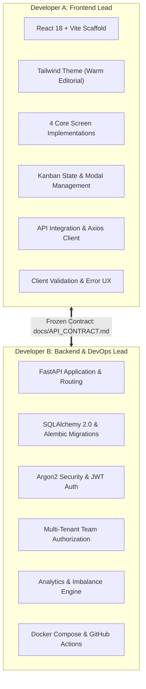
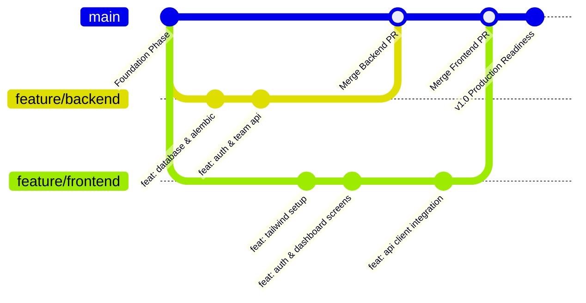

# Crewboard — Development Workflow & Two-Developer Engineering Guide

## 1. Division of Responsibility

Crewboard is developed by a focused two-developer team operating in parallel. To eliminate coordination friction and avoid merge bottlenecks, ownership is strictly partitioned along the system's architectural boundary:



### Detailed Developer Matrices

| Aspect | Developer A (Frontend) | Developer B (Backend & DevOps) |
| :--- | :--- | :--- |
| **Primary Codebase** | `/frontend` | `/backend`, root Docker, `.github` |
| **Core Frameworks** | React 18, Vite, Tailwind CSS, Lucide React, React Router v6 | FastAPI, SQLAlchemy 2.0, Pydantic v2, Alembic, PostgreSQL 16 |
| **Deliverables** | - Design system tokens & fonts<br>- Auth screen (Register/Login)<br>- Dashboard view<br>- Project Kanban workspace<br>- Team & Contribution view<br>- API client with auth interceptor | - PostgreSQL schema & migrations<br>- Auth endpoints & JWT verification<br>- Team, Project, Task CRUD<br>- Multi-tenant guard dependencies<br>- Activity audit logger<br>- Analytics engine & Pytest suite<br>- Docker Compose orchestration |
| **Quality Gate** | Production build passes (`npm run build`), zero ESLint errors, responsive down to tablet/mobile. | All Pytest tests pass, 0 migration drift, Docker Compose boots cleanly, CI passes. |

---

## 2. Git Branching Strategy & Workflow

### 2.1 Branch Topology
The project operates out of a single monorepo. Direct pushes to `main` are restricted.



- **`main`**: The pristine, deployable production branch. Only merges via approved Pull Requests.
- **`feature/frontend`**: Developer A’s active branch for all React, Tailwind, and UI integration.
- **`feature/backend`**: Developer B’s active branch for FastAPI, SQLAlchemy, Alembic, Docker, and tests.

### 2.2 Commit Message Standards (Conventional Commits)
All commit messages must adopt standard imperative semantic formatting:
- `feat: <description>` — New user-facing feature or API endpoint.
- `fix: <description>` — Bug fix in existing functionality.
- `docs: <description>` — Updates to documentation or contracts.
- `test: <description>` — Adding or repairing test suites.
- `refactor: <description>` — Code reorganization without functional change.
- `chore: <description>` — Configuration, dependencies, or toolchain updates.

*Example*: `feat: implement workload imbalance calculation engine`

### 2.3 Pull Request Checklist & Integration Protocol
Before any PR into `main` is merged:
1. **Contract Adherence**: Code strictly obeys `docs/API_CONTRACT.md`. Any proposed schema or endpoint change must be discussed and documented in `docs/API_CONTRACT.md` before implementation.
2. **Secrets Protection**: Verify that no `.env`, `.pem`, tokens, or database passwords are committed.
3. **Local Clean Build**:
   - Backend: Pytest must pass: `pytest -v`
   - Frontend: Vite build must pass: `npm run build`
4. **Peer Review**: The other developer must sign off on the PR.

---

## 3. Local Development Workflows

### 3.1 Environment Configuration
Both developers copy the root environment template:
```bash
cp .env.example .env
```
Ensure `.env` is never committed (protected by `.gitignore`).

---

### 3.2 Developer B (Backend) Setup
In accordance with rule 12, use the existing Conda environment `crewboard`:

```bash
# 1. Activate project environment
conda activate crewboard

# 2. Start PostgreSQL container in the background
docker compose up -d db

# 3. Enter backend directory
cd backend

# 4. Run database migrations
alembic upgrade head

# 5. Start FastAPI development server with hot-reload
uvicorn app.main:app --reload --host 0.0.0.0 --port 8000
```
- API Docs accessible at: `http://localhost:8000/docs`
- Health check: `http://localhost:8000/api/health`

#### Running Backend Tests
```bash
cd backend
pytest -v
```

---

### 3.3 Developer A (Frontend) Setup
Developer A can develop immediately with or without a running backend:

```bash
# 1. Enter frontend directory
cd frontend

# 2. Install dependencies
npm install

# 3. Start Vite development server
npm run dev
```
- Frontend application accessible at: `http://localhost:5173`
- The Vite development server automatically proxies or targets `http://localhost:8000/api` using `VITE_API_URL` defined in `.env`.

#### Frontend Mocking Strategy
While Developer B builds the backend endpoints, Developer A uses the sample JSON payloads defined in `docs/API_CONTRACT.md` in lightweight mock services or local fixtures (e.g., `src/services/mockData.js`). This enables Developer A to complete 100% of the UI, state transitions, and Kanban boards with zero blocking dependencies on backend progress.

---

## 4. Full Docker Compose Orchestration

For holistic verification and final demonstrations, Docker Compose runs all tiers:

```bash
# Build and run all services in detached mode
docker compose up --build -d

# View consolidated live logs
docker compose logs -f

# Shut down services and maintain database volume
docker compose down

# Wipe database volume if full reset is required
docker compose down -v
```

### Container Topology
1. **`db`** (`postgres:16-alpine`): Exposes `5432:5432`, uses persistent named volume `crewboard_pgdata`.
2. **`backend`** (`python:3.11-slim`): Exposes `8000:8000`, depends on `db` healthcheck.
3. **`frontend`** (`node:20-alpine` dev or Nginx static): Exposes `5173:5173` or `80:80`.

---

## 5. Conflict Resolution & Communication Protocol

1. **Shared Files**:
   - `docs/API_CONTRACT.md` is the canonical contract. If a field name needs adjustment, developers must agree in chat/person, update the doc first, and then implement the change.
   - Root `docker-compose.yml` and `.env.example` are maintained by Developer B. Developer A requests environment variable additions rather than directly editing root orchestration.
2. **Database Schema Changes**:
   - Schema changes are executed exclusively via new Alembic migration scripts. Never modify existing historical migration files once merged to `main`.
3. **API Breakages**:
   - Any modification to endpoint paths, required request fields, or response structure is treated as a breaking change requiring explicit bilateral consent.

