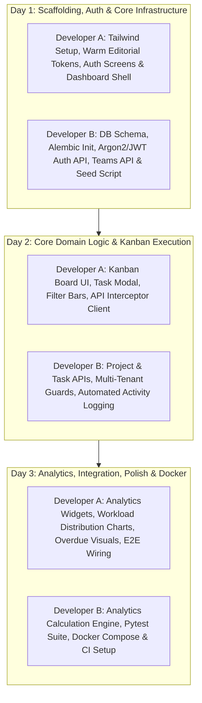

# Crewboard — 2–3 Day Implementation Plan & Milestone Roadmap

## 1. Plan Overview & Execution Principles

This implementation plan is optimized for a **two-developer team** working with **AI assistance (Antigravity)** to produce a production-grade college minor project within **48–72 hours**.

### Guiding Principles
1. **Parallel Execution**: Frontend (Developer A) and Backend (Developer B) proceed independently without blocking each other, using the frozen contracts in `docs/API_CONTRACT.md`.
2. **Ruthless Prioritization**: Strictly execute Mandatory features before attempting any optional capabilities.
3. **Continuous Integration**: Merge into `main` at the end of each day following automated build and test passes.

---

## 2. Day-by-Day Implementation Roadmap

---

### Day 1: Foundation, Security & Workspace Shell

#### Developer A (Frontend)
- [ ] Initialize React 18 + Vite repository structure.
- [ ] Configure Tailwind CSS with the **Warm Editorial** palette:
  - Background `#F4F2EC`, Surface `#FFFEFA`, Primary Text `#263A32`, Secondary `#5D6B62`, Primary Action `#477461`, Accents `#C8795B` (Terracotta) and `#D5B98A` (Sand).
  - Typography: Manrope for headings, Inter for body copy.
  - Border radius standards (`6px`, `10px`, `14px`), subtle border styling (`#E5E1D8`).
- [ ] Implement **Screen 1: Authentication Screen** (`/login` & `/register`):
  - Form validation, clean error messages, toggle between Login and Sign Up.
  - JWT token storage in `localStorage` and authenticated state context (`AuthContext`).
- [ ] Implement layout shell: Top Navigation bar, Team selector, and user profile badge with Lucide icons.
- [ ] Build static scaffold for **Screen 2: Main Dashboard** using contract mock data.

#### Developer B (Backend & DevOps)
- [ ] Scaffold FastAPI project structure (`app/core`, `app/models`, `app/schemas`, `app/api`).
- [ ] Define SQLAlchemy 2.0 ORM models (`User`, `Team`, `TeamMember`, `Project`, `Task`, `ActivityLog`).
- [ ] Initialize Alembic and create the initial migration script (`0001_initial_schema.py`).
- [ ] Configure local PostgreSQL instance with Docker Compose (`db` service).
- [ ] Implement password hashing using Argon2 (`pwdlib` or `passlib`).
- [ ] Implement JWT token issuance and validation utilities (`create_access_token`, `get_current_user`).
- [ ] Implement Authentication API:
  - `POST /api/auth/register`
  - `POST /api/auth/login`
  - `GET /api/auth/me`
- [ ] Implement Teams API:
  - `POST /api/teams` (creates team and owner member, generates unique join code)
  - `GET /api/teams`
  - `POST /api/teams/join`
  - `GET /api/teams/{team_id}`
- [ ] Write initial Pytest fixtures and authentication test cases (`test_auth.py`, `test_teams.py`).

**Day 1 Integration Checkpoint**: Both developers verify that registration, login, and team creation work seamlessly between React UI and FastAPI.

---

### Day 2: Projects, Kanban Workspace & Task Management

#### Developer A (Frontend)
- [ ] Implement **Screen 3: Project Workspace & Kanban Board** (`/projects/:projectId`):
  - Three distinct columns: **To Do**, **In Progress**, **Done**.
  - Task cards displaying title, assignee avatar, priority badge (`low`, `medium`, `high`), due date, and overdue indicator.
  - Interactive status movement (drag-and-drop or clean 1-click status transition buttons).
- [ ] Implement Task Creation & Edit Modal:
  - Title, rich description, priority selector, deadline date picker, and assignee dropdown populated from team members.
- [ ] Implement Filter & Search Bar:
  - Filter by Status (`todo`, `in_progress`, `done`).
  - Filter by Priority (`low`, `medium`, `high`).
  - Filter by Assignee (select specific teammate or "Unassigned").
- [ ] Implement Project Creation Modal from Dashboard.
- [ ] Wire API Client (Axios instance with Bearer token interceptor and 401 redirect).

#### Developer B (Backend & DevOps)
- [ ] Implement Projects API:
  - `POST /api/projects`
  - `GET /api/projects`
  - `GET /api/projects/{project_id}`
- [ ] Implement Tasks API:
  - `POST /api/tasks` (with assignee validation within team)
  - `PATCH /api/tasks/{task_id}` (partial updates, status transitions)
  - `GET /api/projects/{project_id}/tasks` (with query filtering)
- [ ] Implement Multi-Tenant Authorization Security:
  - Ensure zero IDOR vulnerabilities: verify caller belongs to project team before any read/write.
  - Enforce cross-team assignment defense (cannot assign task to user outside project team).
- [ ] Implement Automated Activity Logging Service:
  - Automatically log records in `activity_logs` when tasks are created, assigned, or updated.
  - Implement `GET /api/teams/{team_id}/activity`.
- [ ] Write test cases for tasks and multi-tenant boundary checks (`test_tasks.py`, `test_security.py`).

**Day 2 Integration Checkpoint**: Developer A connects the React Kanban board to live backend endpoints. Tasks can be created, edited, filtered, and moved between columns with immediate persistence and activity logging.

---

### Day 3: Analytics, Team Overview, Final Integration & Containerization

#### Developer A (Frontend)
- [ ] Implement **Screen 4: Team Overview & Contribution Dashboard** (`/teams/:teamId`):
  - Member list with role tags (`Owner`, `Member`) and join date.
  - Team Join Code card with 1-click copy to clipboard.
  - Workload Distribution Bar: visual percentage breakdown of assigned tasks per member.
  - Individual completed task counts and objective metric cards.
  - Prominent alert banners for Workload Imbalance (e.g., "Workload concentration detected") and Overdue items.
- [ ] Refine Main Dashboard with live project statistics and recent activity stream.
- [ ] Add empty states, loading skeletons, and user feedback toast alerts.
- [ ] Ensure responsive behavior and WCAG AA contrast compliance across all screens.

#### Developer B (Backend & DevOps)
- [ ] Implement Analytics Calculation Engine (`GET /api/projects/{project_id}/analytics`):
  - Completion percentage calculation: $\frac{\text{completed\_tasks}}{\text{total\_tasks}} \times 100$.
  - Workload distribution and percentage allocation per user.
  - Overdue task identification (`deadline < now()` and `status != 'done'`).
  - Workload imbalance algorithm:
    - Flag member holding $\ge 50\%$ of tasks when team has $>1$ member and $\ge 4$ tasks.
    - Flag active members with 0 tasks assigned.
- [ ] Finalize Docker Compose configuration (`docker-compose.yml`):
  - `db` (Postgres 16 with persistent volume `crewboard_pgdata`).
  - `backend` (FastAPI with wait-for-db and automatic migration check).
  - `frontend` (Vite dev server or static Nginx bundle).
- [ ] Finalize GitHub Actions workflow (`.github/workflows/ci.yml`):
  - Linting, Pytest execution, and production frontend build check.
- [ ] Run full end-to-end regression tests.

**Day 3 Integration Checkpoint**: Complete end-to-end walkthrough of the live application running in Docker Compose.

---

## 3. Four Core Screens Specification (Developer A Blueprint)

### Screen 1: Authentication (`/login` & `/register`)
- **Layout**: Centered minimal card on `#F4F2EC` background.
- **Components**:
  - Logo and editorial tagline: *"Crewboard — Collaborative Clarity for Student Teams"*.
  - Clean input fields with subtle `#E5E1D8` borders and Manrope labels.
  - Action button styled with Primary Action (`#477461`).
  - Toggle link between "Already have an account? Sign In" and "Need an account? Register".
- **State Behavior**: Submitting stores JWT token and user metadata in `AuthContext` and redirects to `/dashboard`.

### Screen 2: Main Dashboard (`/dashboard`)
- **Layout**: Top nav + 2-column responsive layout (Main content 70%, Activity sidebar 30%).
- **Components**:
  - Greeting header with current user name and active team selector.
  - Quick action buttons: *"New Project"*, *"Join Team with Code"*, *"Create Team"*.
  - Project Cards grid: Displays project name, description preview, deadline badge, and progress bar with percentage.
  - "My Assigned Tasks" panel: Quick checklist of tasks assigned to the current user across projects.
  - Team Activity Feed sidebar: Chronological list of recent actions with actor name, action verb, and relative timestamp.

### Screen 3: Project Workspace & Kanban Board (`/projects/:projectId`)
- **Layout**: Workspace header with breadcrumb navigation, followed by filter bar, then 3-column Kanban board.
- **Components**:
  - Workspace Header: Project title, deadline indicator, completion pill, and "+ Add Task" button.
  - Filter Bar: Status selector pills, Priority dropdown, and Assignee dropdown.
  - Three Columns:
    - **To Do**: Tasks awaiting initiation.
    - **In Progress**: Tasks actively under development.
    - **Done**: Completed deliverables.
  - Task Card:
    - Priority tag: Low (`#526C85`), Medium (`#D5B98A`), High (`#B9534B`).
    - Task title and short description.
    - Assignee initials avatar and due date with red highlight if overdue.
    - Status action trigger (move forward/backward).
  - Task Modal: Full modal for creating or editing title, description, assignee, priority, and deadline.

### Screen 4: Team Overview & Contribution Dashboard (`/teams/:teamId`)
- **Layout**: Team information banner, followed by 2 analytical panels.
- **Components**:
  - Header: Team title, member count, and **Join Code Card** with a prominent "Copy Code" button.
  - Imbalance Warning Box (conditional): Styled in Warm Editorial Warning `#9A5A20` with alert icon, detailing workload concentration or overdue risks.
  - Workload Distribution Chart / Stacked Bar: Visual representation of task distribution among team members.
  - Member Contribution Table:
    - Teammate Name & Email.
    - Role badge (`Owner` in Sand `#D5B98A`, `Member` in neutral).
    - Total tasks assigned.
    - Tasks completed.
    - Completion rate.

---

## 4. Dependencies & Risk Mitigation Matrix

| Risk / Bottleneck | Probability | Impact | Mitigation Strategy |
| :--- | :--- | :--- | :--- |
| **Backend API delay blocks frontend UI work** | Medium | High | **Strict API Contract & Mock Data**: Developer A uses mock fixtures matching `docs/API_CONTRACT.md` exactly, building the entire UI without waiting for backend code. |
| **Cross-team assignment security loopholes** | Low | High | **Domain Guard Functions**: Centralize tenant validation in `app/core/security.py` dependencies. Reject mismatched user IDs before writing tasks. |
| **Docker startup issues on host machines** | Medium | Medium | Developer B tests standard multi-stage Dockerfiles early on Day 1; standard alpine images keep builds lightweight and fast. |
| **Scope creep into optional features** | Medium | High | Strict freeze on comments, real-time WebSockets, and chat. Mandatory scope must be 100% verified first. |

