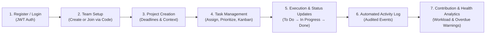
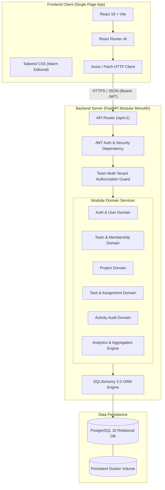

# Crewboard — Project Overview & Architecture Specification

## 1. Executive Summary

**Crewboard** is a centralized, student-centric team project management and contribution tracking platform designed for academic group projects. College collaborative work frequently suffers from three recurring dysfunctions:
1. **Fragmented Communication & Task Sprawl**: Tasks, decisions, and deadlines are scattered across chat applications, shared docs, and email threads.
2. **Hidden Contribution Imbalances**: Free-riding and disproportionate workloads occur unchecked because individual involvement is difficult to quantify objectively.
3. **Opaque Progress & Ambiguous Deadlines**: Neither students nor evaluators have immediate visibility into overall milestone completion, task blockers, or overdue deliverables.

Crewboard replaces generic, chaotic tooling with a focused, **Warm Editorial Productivity** workspace. It enables students to register, assemble teams, initiate projects, assign granular tasks with deadlines and priorities, monitor an interactive Kanban workflow, and review objective, activity-derived contribution analytics.

### Project Context
- **Type**: College Minor Project
- **Team Size**: Exactly 2 Developers (Developer A: Frontend, Developer B: Backend & DevOps)
- **Timeframe**: 2–3 Days
- **Methodology**: Modular Monolith, Strict API-First Contract, AI-Assisted Implementation via Antigravity
- **Primary Goal**: Deliver a dependable, fully functional, visually refined, and demonstrable application without overengineering.

---

## 2. Core User Journey

### Detailed Journey Narrative
1. **Registration & Session Establishment**: A student signs up with their full name, academic email, and secure password. Upon login, a JWT access token is stored client-side in browser storage and attached to subsequent API requests.
2. **Team Assembly**: 
   - A student creates a team (e.g., "CS402 Senior Capstone") and receives a unique 6–8 character uppercase alphanumeric **Join Code** (e.g., `CREW-9482`).
   - Teammates log in and enter this Join Code to immediately join the team as validated members.
3. **Project Scoping**: Team members create projects with defined start dates, target deadlines, and descriptions (e.g., "Autonomous Robot Rover - Sprint 1").
4. **Task Allocation**: Members create tasks with descriptions, priority levels (`low`, `medium`, `high`), target due dates, and assign them strictly to verified team members.
5. **Interactive Execution**: On the project Kanban board, members transition tasks between `todo`, `in_progress`, and `done`.
6. **Automated Activity Auditing**: Every task creation, assignment change, update, and status transition automatically writes an immutable record to the `activity_logs` table.
7. **Objective Health & Workload Analytics**: The project analytics engine reads task states and activity history to compute real-time completion percentages, overdue task alerts, individual task completion counts, and workload concentration warnings (e.g., flagging when a single member carries over 50% of active tasks).

---

## 3. Scope Boundary & Feature Prioritization

To guarantee delivery within the 2–3 day constraint, the scope is governed by strict prioritization.

| Priority Level | Feature Domain | Specific Capabilities |
| :--- | :--- | :--- |
| **Mandatory (Phase 1 & 2)** | **Authentication** | User registration, login, JWT token issue, `/api/auth/me`, protected frontend routes, secure password hashing (Argon2). |
| **Mandatory (Phase 1 & 2)** | **Team Management** | Team creation, unique join-code generation, joining via code, member listing, team-level authorization barriers. |
| **Mandatory (Phase 1 & 2)** | **Project Management** | Project creation within team context, project listing, detail view, deadline tracking, team-boundary access checks. |
| **Mandatory (Phase 1 & 2)** | **Task Management** | Task creation, assignment to verified team members, editing, priorities (`low`, `medium`, `high`), statuses (`todo`, `in_progress`, `done`), multi-criteria filtering. |
| **Mandatory (Phase 1 & 2)** | **Activity Tracking** | Automated capture of task creation, assignment, updates, and status transitions; persistent chronological log. |
| **Mandatory (Phase 1 & 2)** | **Analytics & Health** | Project completion rate (%), total vs. completed count, overdue task list, individual completed task counts, workload distribution chart, workload imbalance alerts. |
| **Deferred / Optional (Phase 3)** | **Collaborative Extras** | Task comments, project announcements, email dispatch, dark mode theme. *(Only initiated if all mandatory features pass QA).* |
| **Strictly Excluded** | **Anti-Scope Items** | Real-time WebSockets/chat, AI chatbots, file/attachment uploads, peer rating questionnaires, gamification/points/badges, microservices, complex multi-tier RBAC. |

> [!IMPORTANT]
> **Integrity of Analytics**: Contribution metrics are strictly grounded in concrete, verifiable events (task completions, active assignments, logged status movements). We do **not** generate synthetic or gamified "effort scores".

---

## 4. System Architecture

Crewboard adopts a **Modular Monolith** architecture. This avoids distributed systems overhead, serialization latency, multi-repo synchronization friction, and deployment complexity, while maintaining strict separation of concerns.

### Architectural Principles
1. **Stateless REST Services**: The backend stores no in-memory session state. All authorization context is derived from the cryptographically signed JWT bearer token and verified against the database.
2. **Strict Multi-Tenant Isolation**: In Crewboard, the `team` is the multi-tenant isolation root. A user can only read, create, or modify projects, tasks, activities, or metrics if they have an active record in `team_members` for that team.
3. **Single Source of Truth**: The PostgreSQL database enforces integrity via foreign keys, cascading deletions, and uniqueness constraints. Business logic validates cross-team boundaries before writing.
4. **Independent Parallel Development**: The frontend and backend communicate exclusively across a frozen, versioned HTTP API contract (`/api/...`). Both developers can stub, mock, and test their components without stepping on shared files.

---

## 5. Technology Stack Rationale

| Layer | Selected Technology | Version | Architectural Justification |
| :--- | :--- | :--- | :--- |
| **Frontend Framework** | React | 18.x | Declarative, mature component model; ideal for reactive Kanban boards and state-driven dashboards. |
| **Build Tooling** | Vite | 5.x / 6.x | Instant hot module replacement (HMR), sub-second bundling, native ES modules. |
| **Styling** | Tailwind CSS | 3.4.x | Utility-first, zero runtime overhead, enables precise design tokens for the Warm Editorial palette. |
| **Icons** | Lucide React | Latest | Clean, modern, consistent stroke icons; zero clutter. |
| **Routing** | React Router | 6.x | Declarative client-side routing with nested layouts and route protection guards. |
| **Backend Runtime** | Python | 3.11+ | High performance, robust typing support, clean async capabilities, standard in modern engineering. |
| **Web Framework** | FastAPI | 0.110+ | Native OpenAPI auto-documentation, rapid Pydantic validation, lightweight execution. |
| **ORM & Data Layer** | SQLAlchemy | 2.0+ | Explicit typed queries, battle-tested connection pooling, reliable relational modeling. |
| **Migrations** | Alembic | Latest | Version-controlled, deterministic database schema evolution. |
| **Security & Auth** | Argon2 / `pwdlib` + `pyjwt` | Modern | Memory-hard, state-of-the-art password hashing; standard RFC 7519 JWT generation and validation. |
| **Database** | PostgreSQL | 16-alpine | Enterprise-grade relational integrity, rich aggregate functions for analytics, ACID compliance. |
| **Testing** | Pytest + HTTPX | Latest | Clean fixture-based testing, synchronous and async API testing client without external server launch. |
| **Containerization** | Docker & Compose | Modern | Identical development, staging, and evaluation environments across host operating systems. |

---

## 6. Non-Functional Requirements & Security Guarantees

### Multi-Tenant Authorization Security
- **No ID Enumeration / Insecure Direct Object References (IDOR)**: Passing arbitrary UUIDs to `/api/projects/{id}` or `/api/tasks/{id}` will trigger a database membership validation. If the caller is not a member of the project's parent team, the API returns `403 Forbidden` (or `404 Not Found`).
- **Assignment Validation**: An assignee for a task must belong to the exact team that owns the project. Cross-team assignment attempts are rejected with `400 Bad Request`.

### Performance & Scalability
- **Sub-100ms API Latency**: Relational indexes on foreign keys (`team_id`, `project_id`, `assigned_to`) and lookup fields (`join_code`, `email`) ensure immediate response times under standard college project workloads.
- **Connection Pooling**: SQLAlchemy pool configuration prevents connection exhaustion.

### Usability & Accessibility (WCAG AA)
- Text contrast ratios exceed 4.5:1 against the Warm Editorial surfaces (`#FFFEFA` and `#F4F2EC`).
- Task priorities and statuses use both distinct semantic color indicators and clear textual labels, ensuring accessibility for color-blind users.

